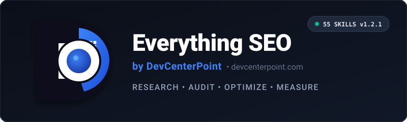
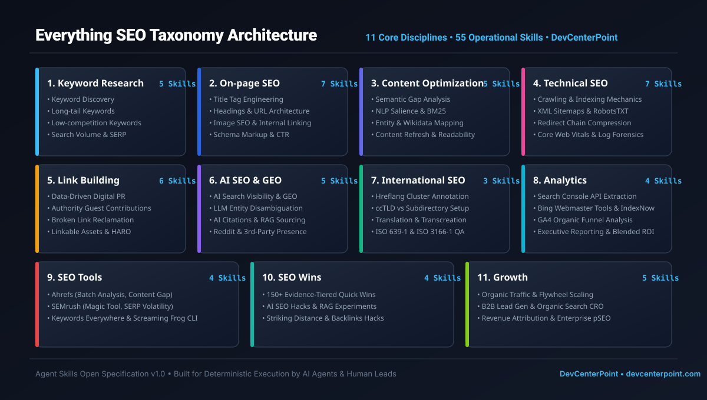
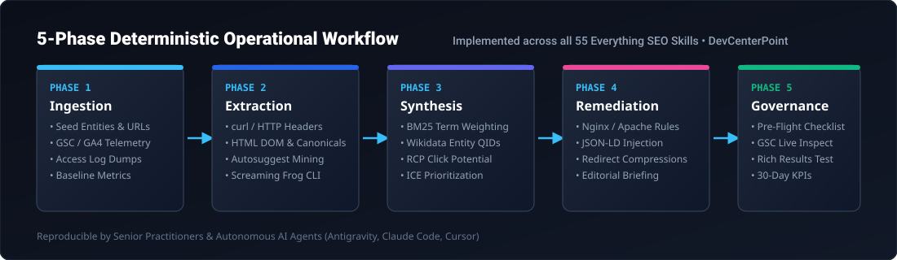

<p align="center">
  <a href="https://devcenterpoint.com">
    
  </a>
</p>

<p align="center">
  <strong>A practical, evidence-based SEO skill library for AI agents and SEO professionals.</strong><br>
  <em>Research. Audit. Optimize. Measure.</em>
</p>

<p align="center">
  <a href="LICENSE"></a>
  <a href="docs/SKILL_WRITING_STANDARD.md"></a>
  <a href="SEO/SKILL_INDEX.md"></a>
  <a href="https://devcenterpoint.com"></a>
</p>

---

## 📌 Mission & Overview

**Everything SEO** is an open-source, deterministic, and evidence-based operational capability library engineered for search professionals and autonomous coding agents.

This repository is **not** an SEO SaaS application, marketing dashboard, or fragile crawler. It is an **actionable, modular knowledge manual**:
- **55 Leaf Operational Skills**: Every topic contains a machine-readable `SKILL.md`.
- **Agent Skills v1.0 Standard**: Uniform **17-section ontology (Sections A through Q)** with valid YAML frontmatter.
- **Strict 4-Tier Epistemic Hierarchy**: Rooted in official IETF RFCs (RFC 3986, RFC 9309, RFC 9110), W3C standards, Schema.org schemas, and Google Search Central / Bing Webmaster documentation.
- **Universal Agent Interoperability**: Turnkey integration with **Cursor IDE**, **Claude Code**, **Google Antigravity**, **GitHub Copilot**, and **Model Context Protocol (MCP)**.
- **100% Offline CI & Zero Paid Tool Lock-In**: Runs completely offline without API keys; provides free CLI, curl, and Python alternatives for every workflow.

---

## 🤖 Universal Agent & Developer Quickstart

Whether you are using Cursor, Claude Code, Antigravity, or developing custom web applications, Everything SEO connects into your workflow in seconds.

### 1. Global System Installation (Install Once, Available to All Agents)
Install skills globally so your AI coding agents discover them automatically across all projects:

```bash
# Option A: Zero-install via npx (Node.js)
npx @devcenterpoint/everything-seo install --global

# Option B: Python package via pip or uv
pip install everything-seo-cli && everything-seo install --global

# Option C: Direct shell one-liner (macOS / Linux)
curl -fsSL https://raw.githubusercontent.com/beingmushfiq/Everything-SEO/main/scripts/install.sh | bash

# Option D: Direct PowerShell one-liner (Windows)
irm https://raw.githubusercontent.com/beingmushfiq/Everything-SEO/main/scripts/install.ps1 | iex
```

### 2. In-Project Installation & Progressive Adoption (The "Shadcn" Pattern)
Add only the specific SEO skills your application requires directly into your project repository. No token bloat, fully customizable, and version-controlled with your code:

```bash
# Initialize SEO capabilities in your active project workspace
everything-seo init

# Initialize with a curated domain preset
everything-seo init --preset nextjs       # Technical Crawling + SSR Schema + Core Web Vitals
everything-seo init --preset ecommerce    # Product Schema + Faceted Nav + Category Optimization
everything-seo init --preset saas         # Competitor Pages + AI Citation + B2B Lead Gen
everything-seo init --preset publisher    # Google News + Entity Coverage + NLP Optimization

# Progressively add individual skills as requirements expand
everything-seo add technical-seo/indexing
everything-seo add on-page-seo/schema-markup
everything-seo add ai-seo/ai-search-visibility

# Scaffold a custom, compliant SEO skill for your company's proprietary rules
everything-seo scaffold --name custom-internal-routing --category "Technical SEO"
```

For complete IDE setups, configuration files, and MCP server instructions, consult the **[Universal Agent Integration Guide](docs/UNIVERSAL_AGENT_INTEGRATION_GUIDE.md)**.

---

## 🏛️ Taxonomy Architecture

<p align="center">
  
</p>

All 55 operational skills reside within the [`SEO/`](SEO/README.md) directory across **11 Core Disciplines**:

```
📂 Everything-SEO
┃
┣ 📂 SEO
┃ ┣ 📂 Keyword Research (5 Skills)      -> Discovery, Long-tail, Low-comp, Search Volume, SERP
┃ ┣ 📂 On-page SEO (7 Skills)           -> Title, Headings, URL, Image, Internal Linking, Schema, CTR
┃ ┣ 📂 Content Optimization (5 Skills)  -> Gap Analysis, NLP Salience, Entity Coverage, Refresh, Readability
┃ ┣ 📂 Technical SEO (7 Skills)         -> Crawling, Indexing, Sitemaps, RobotsTXT, Redirects, Speed, Logs
┃ ┣ 📂 Link Building (6 Skills)         -> Digital PR, Guest Posting, Broken Links, Mentions, Assets, HARO
┃ ┣ 📂 AI SEO (5 Skills)                -> AI Search (GEO), Entity Optimization, Citations, Reddit, 3rd Party
┃ ┣ 📂 International SEO (3 Skills)     -> Hreflang Clusters, Multilingual Setup, Translation & Transcreation
┃ ┣ 📂 Analytics (4 Skills)             -> Search Console, Bing Webmaster, GA4 Funnels, SEO Reporting
┃ ┣ 📂 SEO Tools (4 Skills)             -> Ahrefs, SEMrush, Keywords Everywhere, Screaming Frog CLI
┃ ┣ 📂 SEO Wins (4 Skills)              -> 150+ Evidence Hacks, AI Hacks, Traffic Growth, Backlinks
┃ ┗ 📂 Growth (5 Skills)                -> Organic Traffic, Lead Gen, Conversion (CRO), Revenue, Scaling
┃
┣ 📂 assets/                            <- Brand Mark, Logo, Architecture & Flowchart Vector Assets
┣ 📂 docs/                              <- Launch Strategy, Standards, Demonstrations & Integration Guides
┣ 📂 examples/                          <- 3 Complete End-to-End Worked Case Studies
┣ 📂 templates/                         <- 10 Reusable Deliverable Templates & Presets
┣ 📂 scripts/                           <- Offline Skill Validators, Link Checkers & Agent Adapters
┗ 📂 tests/                             <- Automated Test Suites (unittest & pytest)
```

---

## ⚡ 5-Phase Deterministic Operational Workflow

<p align="center">
  
</p>

Every skill in the library executes through a deterministic five-phase sequence:
1. **Phase 1: Ingestion** — Gather seed entities, baseline GSC/GA4 telemetry, and server access log dumps.
2. **Phase 2: Extraction** — Execute terminal commands (`curl -I`, `grep`, `awk`) and DOM parsers.
3. **Phase 3: Synthesis** — Compute BM25 term salience, reconcile Wikidata QIDs, and calculate Real Click Potential.
4. **Phase 4: Remediation** — Deploy Nginx/Apache configuration blocks, JSON-LD schemas, or editorial briefs.
5. **Phase 5: Governance** — Validate against pre-flight QA checklists, GSC Live Inspection, and 30-day KPIs.

---

## 👥 Who This Repository Serves

1. **Senior SEO Strategists & Technical Leads**: Who require auditable, repeatable diagnostic protocols, triage decision trees, and enterprise-grade deliverables for client audits and in-house growth.
2. **Software Developers & DevOps Engineers**: Who need concrete RFC compliance rules (RFC 3986, RFC 9309, RFC 9110), Nginx/Apache configuration blocks, JSON-LD structured data schemas, and Core Web Vitals remediation steps.
3. **Autonomous AI Agents (Cursor, Antigravity, Claude Code, Copilot, Windsurf)**: Compatible agents can read any `SKILL.md` directly into prompt context, execute the 5-phase procedural workflow, and produce structured deliverables adhering to pre-flight quality checklists.

---

## ⚡ What Makes It Different

| Traditional SEO Content | Everything SEO Library (DevCenterPoint) |
| :--- | :--- |
| **Superficial Advice**: "Write great content and optimize your meta tags." | **Deterministic Protocol**: Exact pixel limits (<=580px), anti-rewrite rules, and GSC CTR anomaly formulas. |
| **Unsubstantiated Folklore**: Keyword density percentages, artificial LSI claims, PBNs. | **Epistemic Classification**: Mandatory separation of Tier 1 verified standards from Tier 3 practitioner estimates. |
| **Fragile SaaS Tools**: Brittle dashboards that break on API changes. | **Permanent Knowledge Infrastructure**: Zero software bloat; runs 100% locally and offline. |
| **Tool Lock-in**: Demands $500/mo subscriptions to commercial tools. | **Free & Open-Source First**: Every skill provides free CLI/curl, GSC, and Python alternatives. |

---

## 🚀 Quick-Start Guide

### Finding the Right Skill for Your Task
Consult the **[Master Skill Index](SEO/SKILL_INDEX.md)** to find the exact capability matching your current operational challenge:

| Scenario / Objective | Target Skill | Primary Deliverable |
| :--- | :--- | :--- |
| Google Search Console reports *"Crawled - currently not indexed"* | [Indexing](SEO/Technical%20SEO/Indexing/SKILL.md) | Indexation & Canonicalization Matrix |
| Organic CTR is low despite ranking in positions 1–3 | [CTR Optimization](SEO/On-page%20SEO/CTR%20Optimization/SKILL.md) | Snippet Optimization Experiment Card |
| Content traffic has decayed over the past 6 months | [Content Refresh](SEO/Content%20Optimization/Content%20Refresh/SKILL.md) | Content Triage & Work Order |
| Need to optimize for Google AI Overviews & Perplexity | [AI Search Visibility](SEO/AI%20SEO/AI%20Search%20Visibility/SKILL.md) | GEO Information Gain Specification |
| Building international multi-region landing pages | [Hreflang](SEO/International%20SEO/Hreflang/SKILL.md) | Hreflang Cluster XML Matrix |

---

## 🔬 Real-World Operational Demonstrations

Explore the **[Demonstrations Index](docs/DEMONSTRATION_INDEX.md)** for complete end-to-end walkthroughs:
- **[E-Commerce Migration Keyword Research](examples/keyword_research_ecommerce_migration.md)**: 5,200 SKU outdoor retailer Shopify Plus migration.
- **[B2B SaaS Semantic Content Gap Analysis](examples/content_gap_b2b_saas.md)**: Zero Trust architecture semantic intersection and Wikidata entity reconciliation.
- **[E-Commerce Technical Forensic Audit](examples/technical_seo_audit_ecommerce.md)**: Crawl log forensics, faceted navigation traps, and Core Web Vitals remediation.

---

## 🤖 Using with Autonomous AI Agents

When prompting Antigravity, Claude Code, Cursor, or an LLM worker:

```markdown
You are acting as an expert technical SEO engineer.
Read and follow the operational methodology in:
SEO/Technical SEO/Indexing/SKILL.md

Target URL: https://example.com/solutions/enterprise/
Diagnose the canonical mismatch reported by Google Search Console.
Execute the 5-phase procedure in Section G and produce the deliverable table in Section J.
Verify all items against Section K before completing the turn.
```

---

## 🧪 Local Testing & Automated Validation

This repository includes a 100% offline automated validation suite. It requires no API keys or internet connection:

```bash
# 1. Install dev dependencies (optional, pytest is optional - unittest works natively)
pip install -r requirements-dev.txt

# 2. Validate all 55 skill files for frontmatter, mandatory sections, and word count
python scripts/validate_skills.py

# 3. Verify all internal relative markdown links resolve on disk
python scripts/check_links.py

# 4. Verify that SKILL_INDEX.md and COVERAGE_REPORT.md match real filesystem
python scripts/generate_index.py --check

# 5. Run the full unit test suite
python -m unittest discover -s tests -p "test_*.py" -v
```

---

## 📚 Community, Governance & Links

- **Universal Integration & Guides**:
  - [Universal Agent Integration Guide](docs/UNIVERSAL_AGENT_INTEGRATION_GUIDE.md)
  - [Strategic Roadmap](ROADMAP.md)
  - [SEO-Eval Benchmark Report](docs/EVAL_BENCHMARK_REPORT.md)
- **Repository Guidelines & Standards**:
  - [Contributing Guidelines](CONTRIBUTING.md)
  - [Skill Writing Standard](docs/SKILL_WRITING_STANDARD.md)
  - [Code of Conduct](CODE_OF_CONDUCT.md)
  - [Security Policy](SECURITY.md)
  - [Support & FAQ](FAQ.md)
- **Project Governance & Release**:
  - [v1.0.0 Release Notes](docs/RELEASE_NOTES_v1.0.0.md)
  - [MIT License](LICENSE)
  - [Changelog](CHANGELOG.md)
  - [Citation File Format (CITATION.cff)](CITATION.cff)
- **Reusable Assets & Demonstrations**:
  - [Demonstrations Index](docs/DEMONSTRATION_INDEX.md)
  - [3 Complete Worked Examples](examples/)
  - [10 Deliverable Templates](templates/)

---

## ⚖️ License & Attribution

Maintained with pride by **[DevCenterPoint](https://devcenterpoint.com)** under the **[MIT License](LICENSE)**.  
Repository: **[`beingmushfiq/Everything-SEO`](https://github.com/beingmushfiq/Everything-SEO)**  
Built for deterministic, repeatable, and verifiable organic search excellence.
