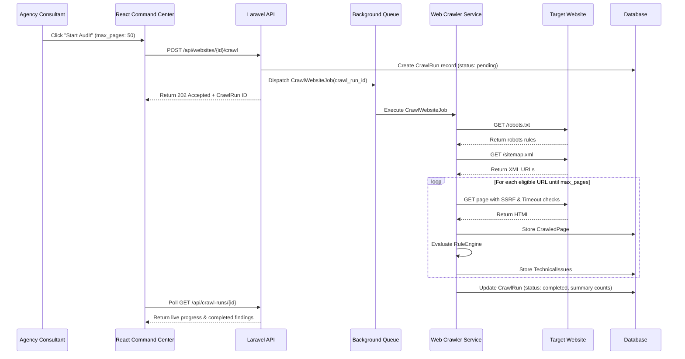

# System Architecture: DevCenterPoint SEO Command Center

## 1. High-Level Architecture Diagram

```mermaid
graph TD
    subgraph Client Layer
        ReactSPA["React 18 + Vite + TypeScript<br/>(Tailwind CSS, Lucide Icons, Recharts)"]
    end

    subgraph API Layer (Laravel 11)
        Router["REST API Router (routes/api.php)"]
        Controllers["Resource Controllers"]
        Services["Domain Services Layer"]
        Policies["Authorization & Scope Policies"]
    end

    subgraph Processing & Background Queues
        QueueWorker["Laravel Queue Worker (database/redis)"]
        CrawlerJob["CrawlWebsiteJob (Rate-limited, Concurrency Controlled)"]
        RuleEngineJob["ExecuteAuditRulesJob"]
        GSCSyncJob["SyncSearchConsoleMetricsJob"]
    end

    subgraph Persistence Layer
        DB[(MySQL 8.0 / SQLite)]
        FileStorage["Storage / Local Disk (Exports & Uploads)"]
    end

    subgraph External Providers
        GSC["Google Search Console API v3"]
        PSI["Google PageSpeed Insights API v5"]
        TargetSites["Target Web Properties (HTTP/HTTPS)"]
    end

    ReactSPA -->|HTTP / JSON (Bearer Token)| Router
    Router --> Controllers
    Controllers --> Policies
    Controllers --> Services
    Services --> DB
    Services --> QueueWorker
    QueueWorker --> CrawlerJob
    QueueWorker --> RuleEngineJob
    QueueWorker --> GSCSyncJob
    CrawlerJob --> TargetSites
    GSCSyncJob --> GSC
    Services --> PSI
```

---

## 2. Component Design & Layer Responsibilities

### 2.1 Frontend Single Page Application (`/frontend`)
- **Framework**: React 18 with TypeScript and Vite for sub-second HMR.
- **Styling**: Tailwind CSS with custom agency design tokens (slate/blue professional color system).
- **State Management & Data Fetching**: Lightweight TanStack Query or standard custom async hooks with caching and optimistic UI updates.
- **Data Visualization**: Recharts for interactive Search Console performance graphs, crawl health breakdown pie charts, and issue severity distribution.
- **Reporting Engine**: Dedicated client-side print layout (`@media print`) and CSV streaming generators.

### 2.2 Backend API (`/api`)
- **Framework**: Laravel 11 running on PHP 8.3+.
- **Architectural Pattern**: Service-Repository pattern with explicit separation of concern:
  - `App\Services\Crawler\CrawlerService`: Handles asynchronous HTTP dispatching, DNS validation, robots.txt parsing, and DOM parsing.
  - `App\Services\Audit\RuleEngine`: Contains pure rule evaluation logic against parsed page metadata.
  - `App\Services\Keywords\KeywordClusterer`: Tokenizes and groups imported keyword datasets.
  - `App\Services\Integrations\GoogleSearchConsoleClient`: Manages OAuth2 token lifecycle and idempotently synchronizes query data.
  - `App\Services\Reports\ReportExporter`: Generates structured CSV and printer-ready executive HTML summaries.

---

## 3. Asynchronous Crawler Pipeline


